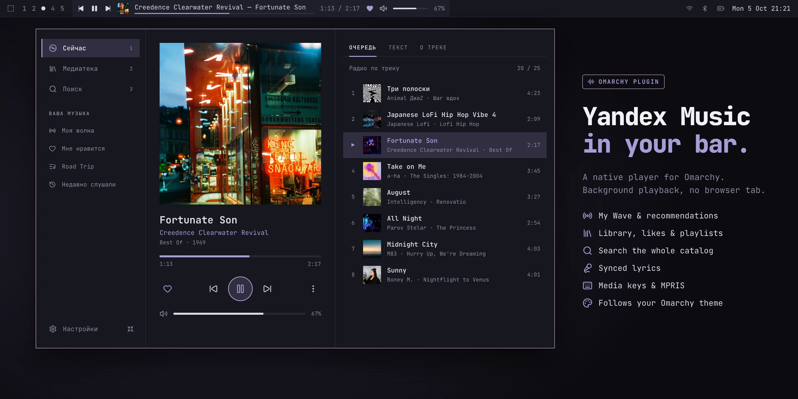

# Yandex Music for Omarchy

[Русский](README.ru.md) · [Changelog](CHANGELOG.md) · [Report an issue](https://github.com/vornashev/omarchy-yandex-music/issues)

A native Yandex Music player in your [Omarchy](https://omarchy.org/) bar. Music plays in the background through `mpv`; the browser is only needed to sign in.

## Installation

For **Omarchy 4.x**. A Yandex Music subscription may be required for full tracks.

```bash
omarchy plugin add https://github.com/vornashev/omarchy-yandex-music.git --enable
```

The first launch sets up the Python environment and background service automatically. No manual clone or `sudo`; allow a moment for setup.

1. Click the player in the bar and choose **Sign in with Yandex**.
2. Copy the code, open the authorization page, and enter it in your browser.
3. Start **My Wave** or choose a track in **Library**. You can close the browser.

<details>
<summary>System requirements</summary>

Internet access, Python 3 (`python`), `mpv`, `jq`, `util-linux` (`flock`) and `coreutils` (`sha256sum`).

</details>

## Interface

<p align="center">
  <a href="preview.webp"></a>
</p>

<p align="center"><em>Wide view · Design previews with demo data, not captures of the running app. Some details may differ.</em></p>

## Features

- **My Wave & radio** — music to match your mood, with likes and recommendation controls.
- **Library & search** — your favorites and the full catalog, without interrupting playback.
- **Playlists** — add tracks, create private playlists and explore recommendations.
- **Lyrics & track info** — synced lyrics with click-to-seek and recording credits.
- **Bar lyrics & mouse gestures** — optional synced lines in the bar, decorative waves on empty LRC lines, and seeking by line or five seconds.
- **Playback** — shuffle, repeat, media keys and resume where you left off.
- **Your layout** — Compact or Wide, Omarchy theme colors and a customizable bar.

## Gallery

Compact keeps the player, library and lyrics in a smaller popup. Press `W` to switch between Compact and Wide.

<p align="center">
  <a href="docs/screenshots/compact.webp"></a>
</p>
<p align="center"><em>Compact view</em></p>

Click any preview to view it full-size.

<p align="center">
  <a href="docs/screenshots/library.webp"></a>
  <a href="docs/screenshots/search.webp"></a>
</p>
<p align="center"><em>Library · Search</em></p>

<details>
<summary>View more screens</summary>

<p align="center">
  <a href="docs/screenshots/my-wave.webp"></a>
  <a href="docs/screenshots/artist.webp"></a>
</p>
<p align="center"><em>My Wave · Artist</em></p>

<p align="center">
  <a href="docs/screenshots/lyrics.webp"></a>
  <a href="docs/screenshots/add-to-playlist.webp"></a>
</p>
<p align="center"><em>Lyrics · Add to playlist</em></p>

<p align="center">
  <a href="docs/screenshots/bar-lyrics.webp"></a>
  <a href="docs/screenshots/bar-wave.webp"></a>
</p>
<p align="center"><em>Bar lyrics · Wave visualizer during pauses</em></p>

<p align="center">
  <a href="docs/screenshots/themes.webp"></a>
  <a href="docs/screenshots/sign-in.webp"></a>
</p>
<p align="center"><em>Themes · Sign-in</em></p>

</details>

## Controls

- **Open the player:** click the artwork or track title in the bar. Right-click the title to play/pause.
- **Volume:** scroll over the track information or volume control; click the speaker to mute.
- **Settings:** open **Actions (⋯)** or use the Wide sidebar. **General** holds playback, restore-on-start and account options; **Top bar** previews the bar player — click an element in the preview to hide or show it.

In **Settings → Top bar**, **Subtitles** and **Mouse controls on text** are independent and disabled by default. With mouse controls enabled, left/right/middle clicks on track information or lyrics play/pause, go next, or go previous; the wheel seeks by five seconds, or by LRC line over subtitles. Artwork still opens the player, and the separate volume control still adjusts volume. Track-information and subtitle widths are set separately with −/+ steppers in 10 px steps; the subtitle width is editable while subtitles are on.

The full information area—from artwork (or the popup icon) through track labels, like, time and subtitles—shares one full-height hover background, including when the pointer is over artwork or the like button. Transport and volume controls stay outside that highlight. In mouse-control mode artwork keeps its own “Open Yandex Music” tooltip and popup action. If artwork is hidden, an `audio-lines` button appears instead, with standard button hover/pressed feedback. It opens the player without pausing or changing tracks; text keeps its playback gestures. The button also preserves the existing fallback when both artwork and track labels are hidden.

Artwork also has a local button highlight on top of the shared background, like the heart button: foreground tint on hover, accent tint while pressed, and a 120 ms hover transition. This feedback works both with and without mouse controls and does not change artwork click actions.

With bar lyrics enabled, the subtitle/wave slot keeps the selected width (**400 px in Auto**, scaled with the UI) while lyrics load, fail, lack timing or are missing. A decorative wave replaces unavailable synchronized text; short or long lines do not resize the slot. Wider explicit presets require enough room for the other bar widgets.

Long synchronized lines scroll once from beginning to end before the next timestamp, with short reading holds at both ends (up to 0.3 seconds each). Scrolling follows playback position: pause freezes it, seeking recomputes it, and even identical consecutive lines restart at their own timestamp. Short lines stay still; the final line uses track duration, or stays at its beginning if no valid end is known. This is independent of track-title scrolling and does not resize the slot. Very short intervals can require fast scrolling.

Lyrics use Yandex first, with [LRCLIB](https://lrclib.net) as a fallback that receives the track title, artist and, for exact lookup, duration—not your Yandex token. Untimed Yandex responses do not block this fallback. Automatic current/next-track loading runs only while bar lyrics are enabled; opening the popup's Lyrics tab also requests lyrics explicitly. Disabling bar lyrics cancels automatic loads, but an already-running Yandex SDK call may finish before its result is discarded. Explicit popup loads remain available. The wave is decorative, not an audio spectrum or a detector of vocal pauses.

LRCLIB uses a **3-second timeout per HTTP request** and at most **two retries, after 1 and 2 seconds**, shared by exact lookup and search. Only timeouts, connection failures and HTTP 408/500/502/503/504 are retried—not 404, missing synchronized text, invalid data or 429. Track changes cancel the previous HTTP transfer and retry wait; stale results cannot replace the new track's lyrics. Legacy plain-text caches are rechecked once; a failed synchronized lookup does not persist plain text as a final result and is retried if you return to that track.

| Key | Action |
| --- | --- |
| `Space` | Play / pause |
| `N` / `P` | Next / previous track |
| `L` / `D` | Like / “Do not recommend” |
| `1` / `2` / `3` | Now Playing / Library / Search; repeat to return to the tab's root |
| `W` | Switch Compact / Wide |
| `Alt+Left` / `Backspace` | Back, except while editing a nonempty text field |
| `Esc` | Close a dialog or settings, go back, then close the popup at a tab root |
| `C` | Copy the sign-in code |

Player shortcuts work while the popup is open, outside text fields and settings. Letter shortcuts also work with the Russian keyboard layout; hardware media keys work through MPRIS.

## Reference

<details>
<summary>Update</summary>

```bash
omarchy plugin update vornashev.yandex-music
```

The player updates automatically when the plugin loads; your sign-in and preferences are preserved.

</details>

<details>
<summary>Troubleshooting</summary>

Check the background service and its log:

```bash
systemctl --user status omarchy-yandex-music.service
journalctl --user -u omarchy-yandex-music.service -n 100
omarchy-yandex-music status | jq '{version, authenticated, loading, error}'
```

If the widget does not appear, try `omarchy restart shell`. When reporting an issue, include the version and error; redact private data from logs and never share `token.json`.

</details>

<details>
<summary>Uninstall & local data</summary>

Remove the plugin, background service, CLI and audio cache while keeping your sign-in, preferences and playback state:

```bash
~/.config/omarchy/plugins/vornashev.yandex-music/uninstall.sh
```

To also remove your sign-in, preferences and playback state, add `--purge` when running the command above.

- Token, playback state and preferences: `~/.config/omarchy-yandex-music/` (files use mode `600`).
- Successful lyrics are cached in `~/.config/omarchy-yandex-music/lyrics/`: up to **128 files**, each at most **1 MiB** when read, with an eight-track memory LRU. Errors and missing lyrics are not persisted; logout clears this cache. This directory is retained by normal uninstall and removed by `--purge`.
- Collections are cached only in memory. The audio cache in `$XDG_CACHE_HOME/omarchy-yandex-music/audio` (default `~/.cache/omarchy-yandex-music/audio`) is capped at **256 MiB**; it is not an offline library.
- MPRIS exposes track metadata and artwork, never temporary audio URLs.

</details>

<details>
<summary>Development</summary>

Run from the repository root; real-audio tests also require `ffmpeg`, and local HTTPS certificate tests require `openssl`:

```bash
python -m compileall -q backend tests
(
  test_home="$(mktemp -d)"
  trap 'rm -rf -- "$test_home"' EXIT
  HOME="$test_home" dbus-run-session -- \
    ~/.local/share/omarchy-yandex-music/venv/bin/python -m unittest discover -s tests
)
QT_QPA_PLATFORM=offscreen /usr/lib/qt6/bin/qmltestrunner -input tests/qml -import .
for smoke in tests/smoke/*/run.sh; do bash "$smoke"; done
for script in bootstrap.sh install.sh uninstall.sh; do bash -n "$script"; done
omarchy plugin validate .
```

The temporary home and session D-Bus isolate tests from your account and desktop player. To deploy local changes, run `./install.sh --backend-only`, then `omarchy restart shell`. See [audio cache validation](docs/audio-cache-validation.md).

mpv verifies HTTPS certificates and ignores user mpv configuration for this dedicated background player. For the vendored dependency's source correspondence and integrity check (not a security audit), see [wheel verification](vendor/README.md).

</details>

---

[MIT](LICENSE) · Unofficial project using [yandex-music-api](https://github.com/MarshalX/yandex-music-api); not affiliated with Yandex.
