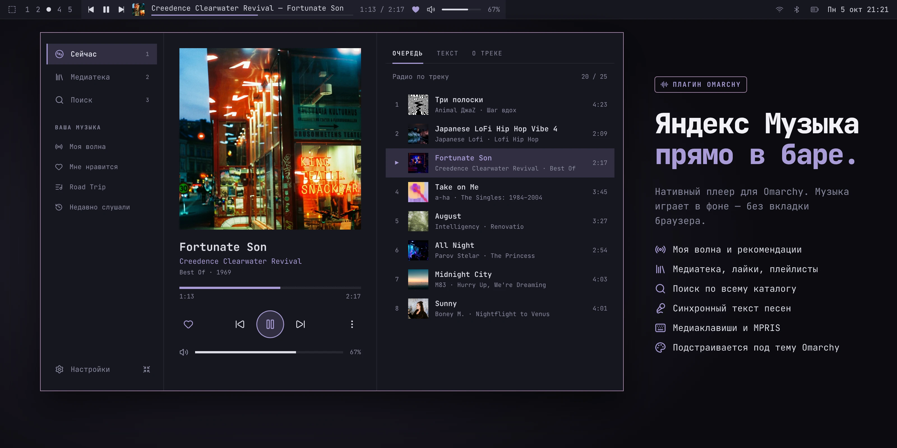
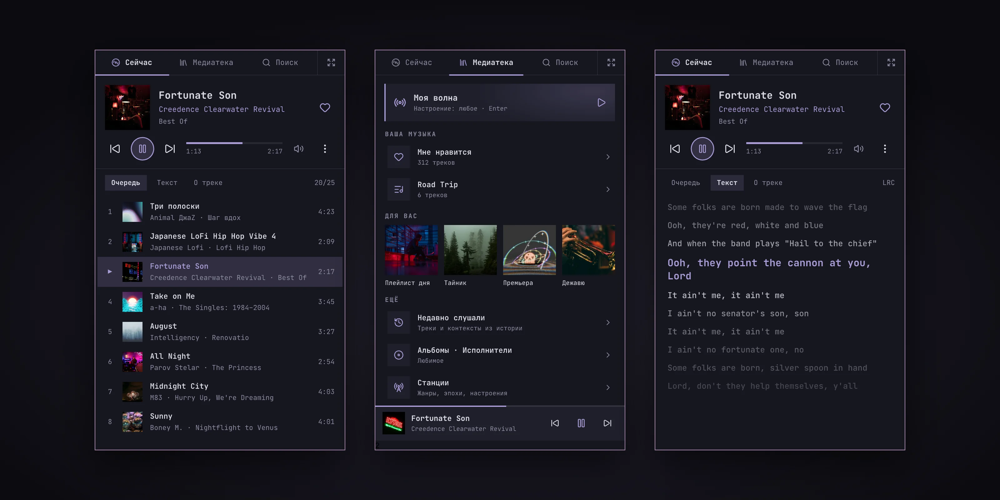
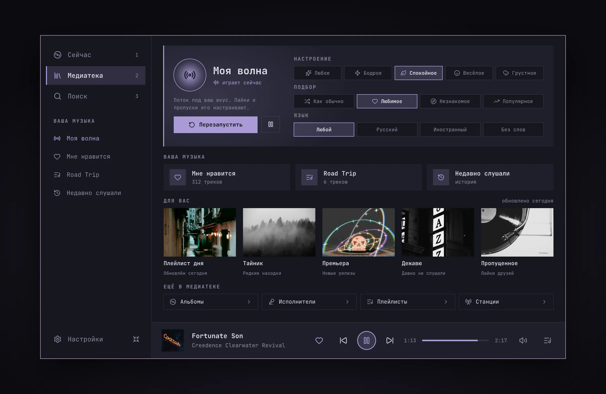
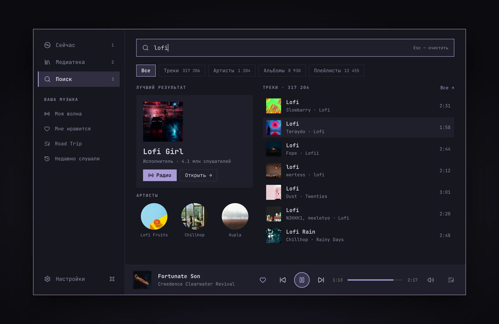
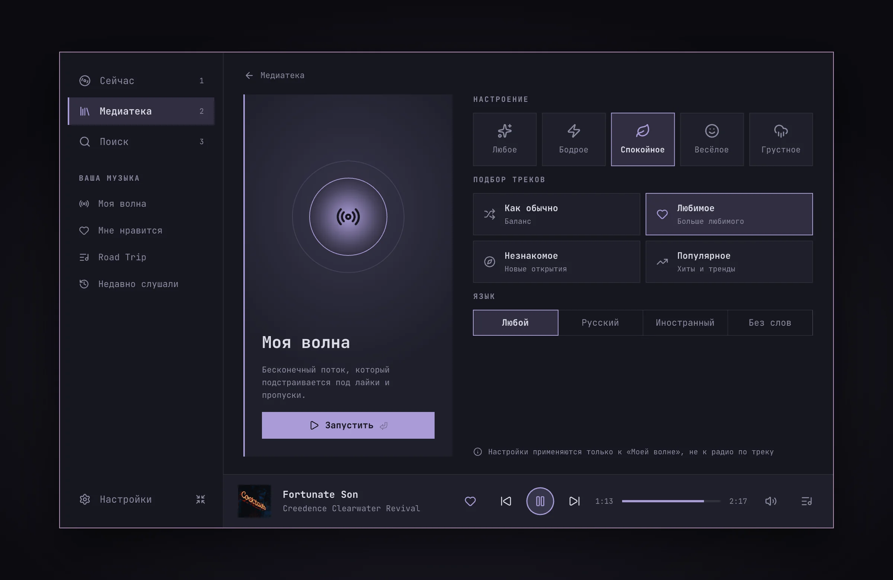
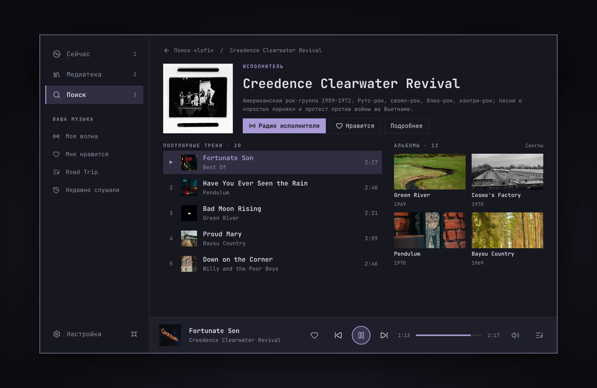
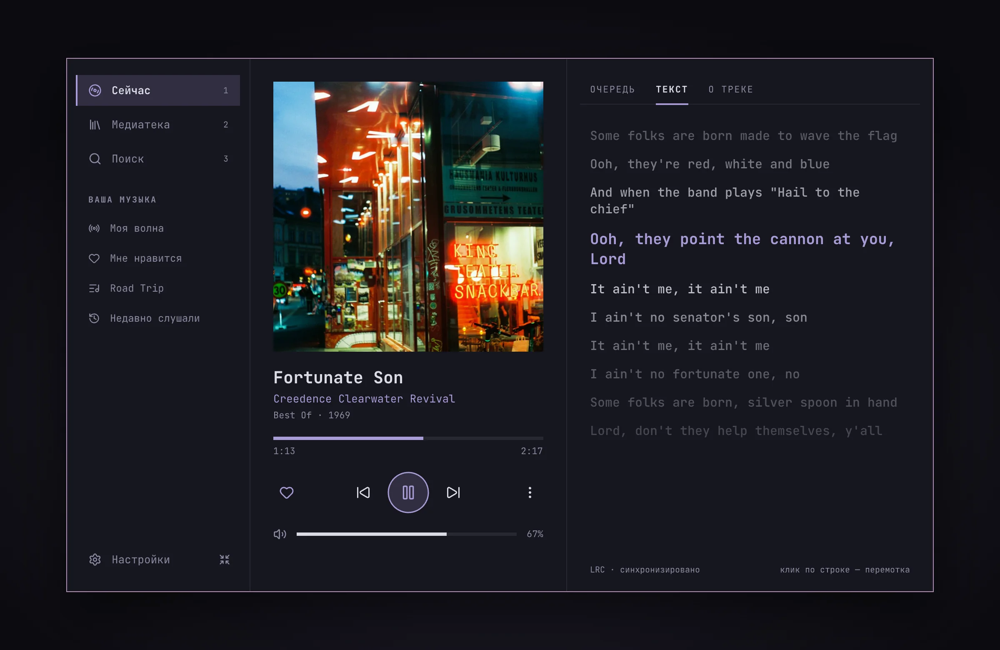
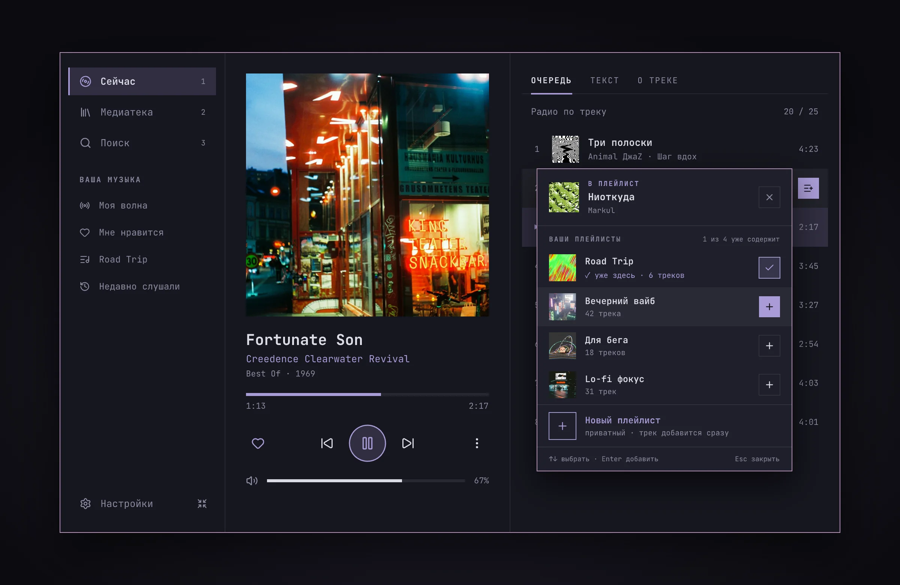
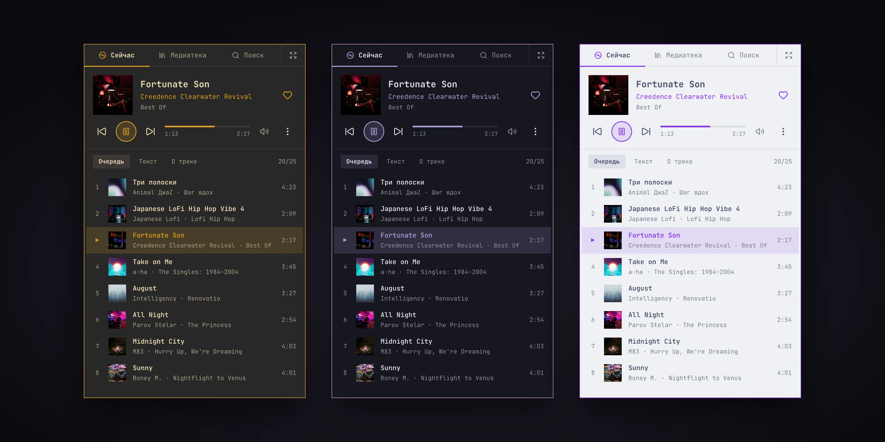
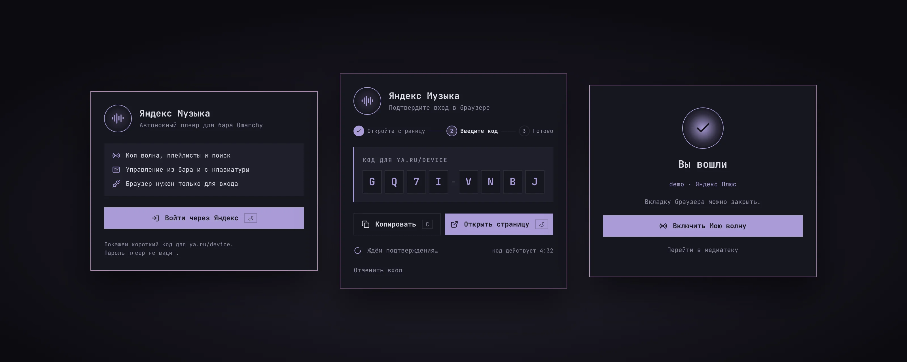

# Яндекс Музыка для Omarchy

[English](README.md) · [История изменений](CHANGELOG.ru.md) · [Сообщить о проблеме](https://github.com/vornashev/omarchy-yandex-music/issues)

Нативный плеер Яндекс Музыки в баре [Omarchy](https://omarchy.org/). Музыка играет в фоне через `mpv`; браузер нужен только для входа.

## Установка

Для **Omarchy 4.x**. Для полных треков может потребоваться подписка Яндекс Музыки.

```bash
omarchy plugin add https://github.com/vornashev/omarchy-yandex-music.git --enable
```

При первом запуске Python-окружение и фоновый сервис установятся автоматически. Без ручного клонирования и `sudo`; дайте установке немного времени.

1. Нажмите на плеер в баре и выберите **«Войти через Яндекс»**.
2. Скопируйте код, откройте страницу авторизации и введите его в браузере.
3. Включите **«Мою волну»** или выберите трек в **«Медиатеке»**. Браузер можно закрыть.

<details>
<summary>Системные требования</summary>

Интернет, Python 3 (`python`), `mpv`, `jq`, `util-linux` (`flock`) и `coreutils` (`sha256sum`).

</details>

## Интерфейс

<p align="center">
  <a href="docs/screenshots/hero-ru.webp"></a>
</p>

<p align="center"><em>Широкий вид · Промо-макеты на демонстрационных данных, не снимки работающего приложения. Отдельные детали могут отличаться.</em></p>

## Возможности

- **Моя волна и радио** — музыка под настроение, лайки и настройка рекомендаций.
- **Медиатека и поиск** — любимое и весь каталог, без прерывания музыки.
- **Плейлисты** — добавление треков, создание приватных плейлистов и рекомендации.
- **Тексты и сведения** — синхронный текст с перемоткой по строке и участники записи.
- **Субтитры и жесты в баре** — отключаемые синхронные строки, декоративная волна на пустых строках LRC и перемотка по строкам или на пять секунд.
- **Воспроизведение** — перемешивание, повтор, медиаклавиши и продолжение с прежнего места.
- **Ваш интерфейс** — Компакт или Широкий вид, цвета темы Omarchy и настраиваемый бар.

## Галерея

Компакт объединяет плеер, медиатеку и тексты в небольшом попапе. Клавиша `W` переключает Компакт и Широкий вид.

<p align="center">
  <a href="docs/screenshots/compact.webp"></a>
</p>
<p align="center"><em>Компактный вид</em></p>

Нажмите на любое изображение, чтобы открыть полный размер.

<p align="center">
  <a href="docs/screenshots/library.webp"></a>
  <a href="docs/screenshots/search.webp"></a>
</p>
<p align="center"><em>Медиатека · Поиск</em></p>

<details>
<summary>Посмотреть остальные экраны</summary>

<p align="center">
  <a href="docs/screenshots/my-wave.webp"></a>
  <a href="docs/screenshots/artist.webp"></a>
</p>
<p align="center"><em>Моя волна · Исполнитель</em></p>

<p align="center">
  <a href="docs/screenshots/lyrics.webp"></a>
  <a href="docs/screenshots/add-to-playlist.webp"></a>
</p>
<p align="center"><em>Текст · Добавление в плейлист</em></p>

<p align="center">
  <a href="docs/screenshots/bar-lyrics.webp"></a>
  <a href="docs/screenshots/bar-wave.webp"></a>
</p>
<p align="center"><em>Субтитры в баре · Волна-визуализатор во время пауз в тексте</em></p>

<p align="center">
  <a href="docs/screenshots/themes.webp"></a>
  <a href="docs/screenshots/sign-in.webp"></a>
</p>
<p align="center"><em>Темы · Вход</em></p>

</details>

## Управление

- **Открыть плеер:** нажмите на обложку или название трека в баре. Правый клик по названию переключает воспроизведение и паузу.
- **Громкость:** прокрутите колесо над информацией о треке или регулятором; кнопка динамика выключает звук.
- **Настройки:** откройте меню **«Действия» (⋯)** или воспользуйтесь широкой боковой панелью. Во вкладке **«Основные»** — воспроизведение, восстановление при запуске и аккаунт; **«Верхний бар»** показывает предпросмотр плеера — клик по элементу скрывает или показывает его.

В **Настройках → Верхний бар** «Субтитры» и «Управление кликами по тексту» независимы и по умолчанию выключены. При включённых жестах левый/правый/средний клик по информации о треке или субтитрам переключает паузу, следующий или предыдущий трек; колесо перематывает на пять секунд, а над субтитрами — по строкам LRC. Обложка по-прежнему открывает плеер, отдельный регулятор громкости по-прежнему меняет громкость. Ширина названия трека и ширина субтитров задаются отдельно кнопками −/+ с шагом 10 px; ширина субтитров меняется, когда субтитры включены.

Вся информационная область — от обложки (или иконки открытия плеера) через подписи трека, лайк, время и субтитры — имеет общий hover-фон на всю высоту бара, в том числе при наведении на обложку или лайк. Transport и громкость остаются за пределами подсветки. В режиме управления кликами обложка сохраняет собственную подсказку «Открыть Яндекс Музыку» и действие открытия попапа. Если обложка скрыта, вместо неё появляется кнопка `audio-lines` со стандартным hover/нажатием. Она открывает плеер без паузы или переключения трека; жесты на тексте сохраняются. Кнопка также сохраняет прежний резервный вариант, когда скрыты и обложка, и подписи трека.

Поверх общего фона у обложки есть локальная подсветка, как у кнопки сердца: оттенок foreground при наведении, accent при удержании кнопки мыши и переход hover за 120 мс. Она работает как с управлением кликами, так и без него; действия кликов по обложке не меняются.

При включённых субтитрах поле текста/волны сохраняет выбранную ширину (**400 px в Auto** с учётом масштаба интерфейса) при загрузке, ошибке, отсутствии таймкодов или текста. Вместо недоступного синхронного текста показывается декоративная волна; короткие и длинные строки не меняют ширину поля. Более широкие явные варианты требуют свободного места для остальных виджетов бара.

Длинные синхронные строки один раз прокручиваются от начала до конца до следующей временной метки, с короткими задержками для чтения по краям (до 0,3 секунды каждая). Прокрутка следует позиции воспроизведения: пауза её останавливает, перемотка пересчитывает, даже одинаковые соседние строки начинают свой проход с собственной метки. Короткие строки неподвижны; последняя использует длительность трека или остаётся в начале, если корректное время окончания неизвестно. Настройка бегущего названия трека на это не влияет, ширина поля не меняется. При очень коротком интервале прокрутка может быть быстрой.

Текст сначала запрашивается у Яндекса; резервный [LRCLIB](https://lrclib.net) получает название трека, исполнителя и, для точного поиска, длительность — не токен Яндекса. Ответ Яндекса без таймкодов не блокирует резервный источник. Автоматическая загрузка текущего и следующего трека работает только при включённых субтитрах; открытие вкладки «Текст» в попапе также явно запрашивает текст. Выключение субтитров отменяет автоматические загрузки, но уже выполняющийся вызов SDK Яндекса может завершиться до отбрасывания результата. Ручная загрузка в попапе остаётся доступной. Волна декоративная: это не аудиоспектр и не детектор пауз вокала.

У LRCLIB **таймаут 3 секунды на HTTP-запрос** и не больше **двух повторов через 1 и 2 секунды**, с общим бюджетом для точного поиска и поиска по названию. Повторяются только таймауты, ошибки соединения и HTTP 408/500/502/503/504 — не 404, отсутствие синхронного текста, некорректные данные или 429. Переключение трека отменяет прежний HTTP-запрос и ожидание повтора; старый результат не может заменить текст нового трека. Старый кэш обычных текстов один раз перепроверяется; при неудачном поиске синхронизации обычный текст не сохраняется на диск как окончательный результат и перепроверяется при возвращении к треку.

| Клавиша | Действие |
| --- | --- |
| `Space` | Воспроизведение / пауза |
| `N` / `P` | Следующий / предыдущий трек |
| `L` / `D` | Лайк / «Не рекомендовать» |
| `1` / `2` / `3` | «Сейчас» / «Медиатека» / «Поиск»; повтор — к корню вкладки |
| `W` | Переключить Компакт / Широкий вид |
| `Alt+Left` / `Backspace` | Назад, кроме редактирования непустого текстового поля |
| `Esc` | Закрыть диалог или настройки, вернуться назад, на корне вкладки — закрыть попап |
| `C` | Скопировать код входа |

Команды плеера работают при открытом попапе вне текстовых полей и настроек. Буквенные клавиши работают и в русской раскладке; аппаратные медиаклавиши — через MPRIS.

## Справка

<details>
<summary>Обновление</summary>

```bash
omarchy plugin update vornashev.yandex-music
```

Плеер обновится автоматически при загрузке плагина; вход в аккаунт и настройки сохранятся.

</details>

<details>
<summary>Диагностика</summary>

Проверьте фоновый сервис и его журнал:

```bash
systemctl --user status omarchy-yandex-music.service
journalctl --user -u omarchy-yandex-music.service -n 100
omarchy-yandex-music status | jq '{version, authenticated, loading, error}'
```

Если виджет не появился, попробуйте `omarchy restart shell`. Для сообщения о проблеме укажите версию и ошибку; уберите личные данные из журнала и не публикуйте `token.json`.

</details>

<details>
<summary>Удаление и локальные данные</summary>

Удалить плагин, фоновый сервис, CLI и аудиокэш, сохранив вход в аккаунт, настройки и состояние воспроизведения:

```bash
~/.config/omarchy/plugins/vornashev.yandex-music/uninstall.sh
```

Чтобы удалить также вход в аккаунт, настройки и состояние воспроизведения, добавьте `--purge` при запуске команды выше.

- Токен, состояние и настройки: `~/.config/omarchy-yandex-music/` (права файлов — `600`).
- Успешно загруженные тексты кэшируются в `~/.config/omarchy-yandex-music/lyrics/`: до **128 файлов**, каждый читается с пределом **1 МиБ**, плюс LRU на восемь треков в памяти. Ошибки и отсутствие текста не сохраняются на диск; выход из аккаунта очищает кэш. Обычное удаление плагина сохраняет этот каталог, `--purge` удаляет его.
- Коллекции кэшируются только в памяти. Аудиокэш в `$XDG_CACHE_HOME/omarchy-yandex-music/audio` (по умолчанию `~/.cache/omarchy-yandex-music/audio`) ограничен **256 МиБ**; это не офлайн-библиотека.
- MPRIS передаёт метаданные и обложку, но не временные ссылки на аудио.

</details>

<details>
<summary>Разработка</summary>

Запускайте из корня репозитория; тестам настоящего аудио также нужен `ffmpeg`, а локальным HTTPS-тестам сертификатов — `openssl`:

```bash
python -m compileall -q backend tests
(
  test_home="$(mktemp -d)"
  trap 'rm -rf -- "$test_home"' EXIT
  HOME="$test_home" dbus-run-session -- \
    ~/.local/share/omarchy-yandex-music/venv/bin/python -m unittest discover -s tests
)
QT_QPA_PLATFORM=offscreen /usr/lib/qt6/bin/qmltestrunner -input tests/qml -import .
for smoke in tests/smoke/*/run.sh; do bash "$smoke"; done
for script in bootstrap.sh install.sh uninstall.sh; do bash -n "$script"; done
omarchy plugin validate .
```

Временный домашний каталог и отдельный session D-Bus изолируют тесты от аккаунта и плеера рабочего стола. Для установки локальных изменений выполните `./install.sh --backend-only`, затем `omarchy restart shell`. См. [проверку аудиокэша](docs/audio-cache-validation.md).

mpv проверяет HTTPS-сертификаты и не читает пользовательскую конфигурацию mpv для этого отдельного фонового плеера. Проверка соответствия vendored-зависимости исходникам и её целостности (не аудит безопасности) описана в [документации wheel](vendor/README.ru.md).

</details>

---

[MIT](LICENSE) · Неофициальный проект на базе [yandex-music-api](https://github.com/MarshalX/yandex-music-api), не связан с компанией Яндекс.
